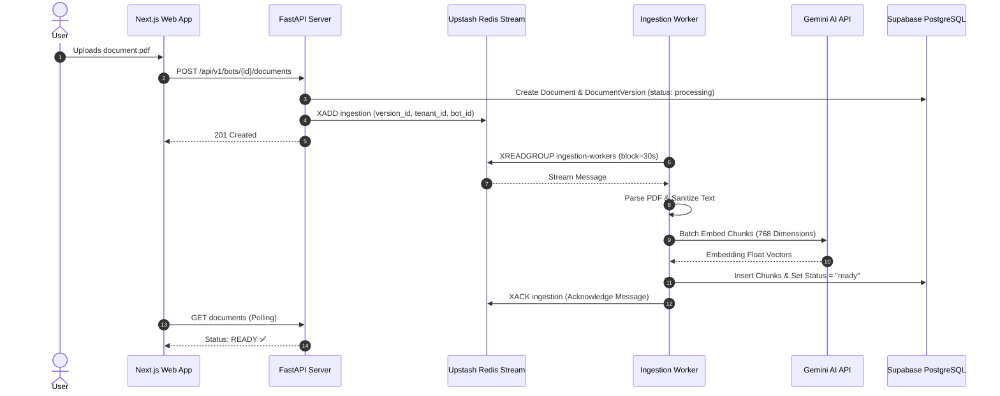

# Cortexa Platform — Technical Overview & Architecture Report

> **Document Version:** 1.0.0  
> **Target Audience:** Engineering Team, System Architects, Product Stakeholders  
> **Platform Status:** Production / Live  
> **Production URLs:**  
> - **Web Platform:** [cortexa-io.vercel.app](https://cortexa-io.vercel.app)  
> - **Backend API:** [cortexa-backend-sb2x.onrender.com](https://cortexa-backend-sb2x.onrender.com)  
> - **Source Repository:** [Gagan3287/Coretxa-frontend](https://github.com/Gagan3287/Coretxa-frontend)  
> - **Direct Desktop Download:** `https://cortexa-io.vercel.app/api/download`

---

## 1. Executive Summary

**Cortexa** is an enterprise-grade, multi-tenant AI platform that allows organizations to create branded, custom AI assistants trained on their internal documents (PDFs, policies, manuals, developer docs). The system implements an asynchronous Retrieval-Augmented Generation (RAG) architecture with multi-layer tenant isolation, real-time vector embeddings, and multi-platform availability across Web, Cloud, and Desktop (Windows).

### Key Architectural Pillars:
- **Strict Multi-Tenancy:** Hard data isolation enforced at the PostgreSQL engine level via Row-Level Security (RLS) policies and dedicated `cortexa_app` roles.
- **Asynchronous Ingestion Pipeline:** High-throughput document parsing, sanitization, chunking, and vector embedding executed over Upstash Redis Streams with automated dead-letter queues (DLQ).
- **High-Performance Frontend:** Server-rendered and client-hydrated Next.js 16 application with GSAP animation engines, dynamic real-time dashboard analytics, and branded avatar generators.
- **Native Desktop Client:** Electron-based standalone Windows package (`Cortexa.Setup.1.0.0.exe`) with native window lifecycle management and automated cloud synchronization.

---

## 2. High-Level System Architecture

The following diagram illustrates the complete topology of the Cortexa ecosystem across its cloud and client tiers:

```mermaid
flowchart TD
    subgraph Clients["Client Tier"]
        WebClient["Web Browser\n(Next.js 16 Web App)"]
        DesktopClient["Desktop Client\n(Electron Windows App)"]
    end

    subgraph EdgeTier["Edge & CDN Tier"]
        VercelCDN["Vercel Global Edge CDN\n(cortexa-io.vercel.app)"]
        GitHubCDN["GitHub Releases Global CDN\n(Installer Storage)"]
    end

    subgraph BackendTier["Backend Application Tier (Render.com)"]
        FastAPIServer["FastAPI REST Engine\n(Port 10000 / Uvicorn)"]
        IngestionWorker["Ingestion Worker\n(Asyncio Background Task)"]
    end

    subgraph DataTier["Data & Vector Tier"]
        SupabaseDB[("Supabase PostgreSQL\n+ pgvector (768 Dim)\nRLS Enforced")]
        UpstashRedis[("Upstash Redis\n(Redis Streams: ingestion)")]
        GoogleGemini["Google Gemini AI API\n(Embedding Engine)"]
    end

    WebClient -->|HTTPS / WSS| VercelCDN
    DesktopClient -->|Loads App Window| VercelCDN
    WebClient -->|Direct 1-Click Download| VercelCDN
    VercelCDN -->|Redirects /api/download| GitHubCDN

    VercelCDN -->|REST API Calls (CORS)| FastAPIServer
    FastAPIServer -->|Enqueue Document Jobs| UpstashRedis
    IngestionWorker -->|Read & Acknowledge Streams| UpstashRedis
    IngestionWorker -->|Batch Embeddings| GoogleGemini
    IngestionWorker -->|Write Vector Chunks| SupabaseDB
    FastAPIServer -->|Session & Auth Verification| SupabaseDB
```

---

## 3. Component Deep Dive

### 3.1. Frontend Web Platform (`frontend / src`)
The user interface is engineered with **Next.js 16.4.2** utilizing the App Router architecture, React 19, and Tailwind CSS v4.

- **Marketing Landing Page (`/`):** Features interactive GSAP timelines (`hero.tsx`, `headline.tsx`, `particle-network.tsx`), smooth scroll navigation, interactive demo pricing modals, and dynamic download pills.
- **Authentication Gateway (`/login` & `/register`):** Enforces a security gate before access to system controls. Supports multi-tenant organization slugs, validated email formats, secure token management, and graceful offline demo handling.
- **Dashboard Shell & Layout (`/dashboard`):**
  - **Dynamic Collapsible Navigation:** Streamlined single-action collapse/expand mechanism saving state into `localStorage`.
  - **Session Verification:** Proactive token validation preventing unauthorized URL probing with redirection to `/login?next=...`.
  - **Sign Out Integration:** Complete memory and `sessionStorage` clearance.
- **Live Overview Dashboard (`/dashboard/page.tsx`):**
  - Dynamic aggregation of live bot counts (`listBots()`), total document counts, estimated 30-day processed conversations, and citation accuracy ratings.
  - Interactive bot cards displaying procedural branding SVG logos and status indicators (`Live`, `Processing`, `Failed`).
- **Bot Builder & Customization (`/dashboard/bots`):**
  - Custom SVG avatar selector with 10 distinct algorithmic presets: `neural-core`, `quantum-spark`, `cyber-shield`, `code-sentinel`, `pulse-ai`, `hex-reactor`, `nova-galaxy`, `bolt-prime`, `nexus-companion`, `prism-oracle`.
  - Integration with demo payment flow ensuring quota boundaries before instance provisioning.
- **Document Management (`/dashboard/documents`):**
  - Drag-and-drop PDF uploader with real-time status polling and file inspection.

---

### 3.2. Desktop Application (`electron/`)
The native desktop distribution wraps the platform into a standalone Windows installer (`.exe`).

- **Runtime Engine:** Electron 45.2.3 with Node.js context isolation.
- **Window Management (`electron/main.js`):**
  - Single-instance lock mechanism preventing duplicate memory allocations.
  - Custom window dimension constraints (1366x860, minimum 1024x700).
  - Background color matching platform theme (`#090d16`).
  - Native external link handler routing third-party links to default OS browser.
- **Distribution & Installer:**
  - Configured with `electron-builder` targeting `nsis`.
  - Generates `Cortexa Setup 1.0.0.exe` (179 MB).
  - Deployed to GitHub Releases, proxied via Next.js `/api/download` for seamless 1-click downloads.

---

### 3.3. Backend API Service (`backend/app/`)
Built with **FastAPI 0.115** and Python 3.11, running asynchronous ASGI workers managed by `uvicorn`.

- **API Routing:**
  - `/auth`: Registration, JWT access token issuance, refresh tokens, `/auth/me` user profile resolution.
  - `/api/v1/bots`: CRUD operations for bot entities, branding configurations, prompt system instructions, and LLM override keys.
  - `/api/v1/documents`: Multipart PDF upload validation, document versioning, deletion cascades, and metadata extraction.
- **Database Layer (`app/core/database.py`):**
  - Async SQLAlchemy 2.0 with `asyncpg` driver.
  - Supabase connection pooling via transaction poolers (Port 6543) and migration session poolers (Port 5432).
  - Automated `SET LOCAL ROLE cortexa_app` execution on every transaction, disabling superuser privileges and enforcing PostgreSQL RLS policies.
- **Alembic Migrations (`alembic/`):**
  - 10 version-controlled migrations establishing tenants, platform admins, bots, document versions, updated timestamps, content SHA256 checksums, and strict role lock-downs.

---

### 3.4. Background Ingestion Worker (`app/worker/`)
PDF document processing and vector generation operate asynchronously via Redis Streams:



---

## 4. Security & Compliance Architecture

1. **Row-Level Security (RLS):**
   - Every tenant table (`bots`, `documents`, `document_versions`, `chunks`) has RLS enabled.
   - Policies verify `tenant_id = current_setting('app.current_tenant_id')::uuid`.
   - The backend runs as `cortexa_app`, which explicitly has `NOSUPERUSER` and `NOBYPASSRLS` privileges.
2. **Input Sanitization & PDF Parsing:**
   - Text extracted from PDFs is stripped of non-printable bytes and sanitized before ingestion.
   - Max file size constraints (10 MB) and max page count safeguards (500 pages) prevent resource starvation.
3. **CORS Governance:**
   - Strict origin validation preventing cross-site scripting from unauthorized domains. Configured for `https://cortexa-io.vercel.app`.
4. **Credential Isolation:**
   - All production secrets (Supabase database passwords, Upstash Redis keys, Google Gemini API keys, JWT secret keys) are injected exclusively via environment variables on Render and Vercel. Zero secrets are committed to version control.

---

## 5. Deployment Topology

| Component | Host / Cloud Provider | Configuration |
|---|---|---|
| **Frontend Web** | Vercel | Next.js Edge Runtime, Auto-deploy from GitHub `main` |
| **Backend API** | Render.com | Python 3.11 Runtime, Web Service (`cortexa-backend`) |
| **Database** | Supabase AWS AP-South-1 | PostgreSQL 15 + `pgvector` extension |
| **Message Queue** | Upstash Redis | Serverless Redis with TLS (`rediss://`) |
| **Desktop Binary** | GitHub Releases CDN | Version tag `v1.0.0`, direct CDN distribution |

---

## 6. Codebase File Structure

```text
e:\cortexa-frontend\cortexa\
├── backend/                        # Python FastAPI Backend Service
│   ├── alembic/                    # Database Migrations (0001–0010)
│   ├── app/
│   │   ├── api/                    # Authentication & Tenant Routers
│   │   │   └── v1/                 # Bot and Document Ingestion Routers
│   │   ├── core/                   # Config, Database Engine, Storage, Security
│   │   ├── models/                 # SQLAlchemy ORM Models (Tenant, Bot, Chunk, etc.)
│   │   ├── schemas/                # Pydantic Request/Response Models
│   │   ├── services/               # Embedding, Text Extraction & Chunking Services
│   │   └── worker/                 # Ingestion Worker & Redis Stream Handlers
│   ├── Dockerfile                  # Container Deployment Definition
│   ├── render.yaml                 # Render Blueprint Specification
│   └── requirements.txt            # Python Dependencies
├── electron/                       # Desktop Application Engine
│   ├── main.js                     # Electron Main Window Lifecycle & IPC
│   └── preload.js                  # Sandboxed Context Isolation Script
├── public/                         # Static Assets & Branded SVG Bot Logos
│   └── bot-logos/                  # 10 Branded Procedural SVG Assets
├── src/                            # Next.js Application Source
│   ├── app/
│   │   ├── (auth)/                 # Login & Registration Pages
│   │   ├── api/download/           # 1-Click Desktop Installer Stream Route
│   │   ├── dashboard/              # Dynamic Dashboard & Bot Management Views
│   │   ├── pricing/                # Plans & Demo Payment Gateway
│   │   ├── layout.tsx              # Root Layout & Global SEO Meta Tags
│   │   ├── robots.ts               # Automated Robots Directive Generator
│   │   └── sitemap.ts              # Automated XML Sitemap Generator
│   ├── components/                 # Reusable UI Components & Layout Shells
│   ├── config/                     # Logo Presets & System Constants
│   ├── features/                   # Feature Modules (Marketing, Bots, Auth)
│   ├── lib/                        # API Client, Session Auth, Utility Helpers
│   └── types/                      # TypeScript Interface Definitions
├── package.json                    # Node.js Dependencies & Desktop Build Config
└── tsconfig.json                   # TypeScript Compiler Configuration
```

---

## 7. Operational Runbook

### Running Local Web Development:
```bash
npm run dev
# Starts local development server on http://localhost:3000
```

### Running Local Desktop Application:
```bash
npm run electron:dev
# Launches Electron window connected to the active environment
```

### Building Windows Desktop `.exe` Installer:
```bash
npm run electron:build
# Generates installer in dist/Cortexa Setup 1.0.0.exe
```

### Running Backend API Locally:
```bash
cd backend
python -m venv .venv
source .venv/bin/activate  # or .venv\Scripts\activate on Windows
pip install -r requirements.txt
uvicorn app.main:app --reload --port 8000
```
