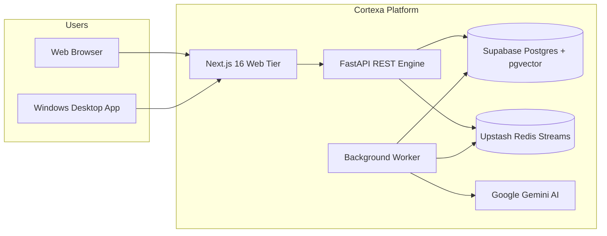
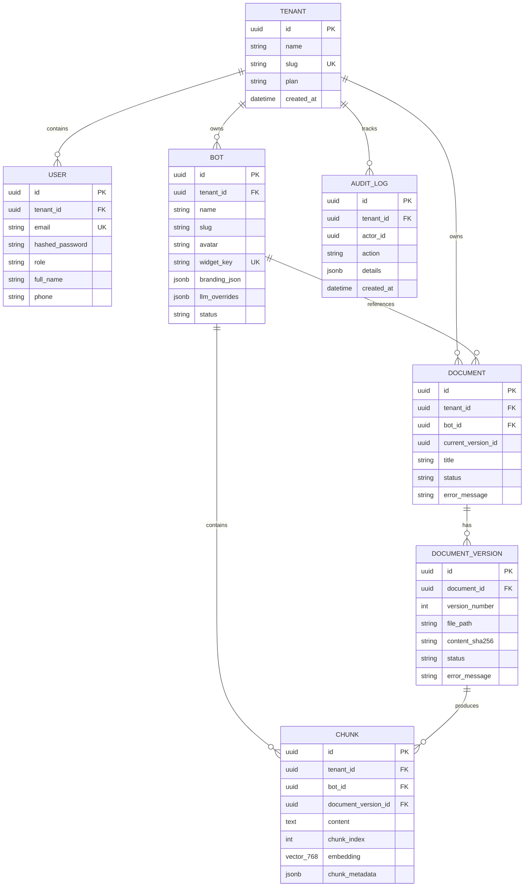

# Software Requirements Specification (SRS)
## For Cortexa: Multi-Tenant AI Assistant & Document Intelligence Platform

> **Standard:** Conforms to IEEE Std 830-1998 / ISO/IEC/IEEE 29148  
> **Document Identifier:** SRS-CORTEXA-2026-V1.0  
> **Status:** Approved / Production Baseline  
> **Date:** November 2026  
> **Author:** Cortexa Engineering Team  

---

## 1. Introduction

### 1.1 Purpose
This Software Requirements Specification (SRS) defines the complete functional, non-functional, behavioral, and interface requirements for the **Cortexa** platform. It provides a formal contract between stakeholders, developers, software testers, and infrastructure engineers.

### 1.2 Scope of the System
Cortexa is a multi-tenant SaaS application that enables enterprises and organizations to:
1. Ingest proprietary unstructured documents (primarily PDFs).
2. Cleanse, chunk, and embed documents into high-dimensional vector representations.
3. Deploy isolated AI assistant bots configured with custom personas, branding SVG avatars, and domain contexts.
4. Execute grounded document retrieval and conversational query answering via high-speed vector similarity search.
5. Provide access via a modern web interface and a standalone Windows desktop executable (`.exe`).

### 1.3 Definitions, Acronyms, and Abbreviations
- **API:** Application Programming Interface
- **CORS:** Cross-Origin Resource Sharing
- **DLQ:** Dead-Letter Queue (Redis Stream error queue)
- **JWT:** JSON Web Token
- **NFR:** Non-Functional Requirement
- **NSIS:** Nullsoft Scriptable Install System
- **ORM:** Object-Relational Mapping (SQLAlchemy)
- **RAG:** Retrieval-Augmented Generation
- **RLS:** Row-Level Security (PostgreSQL)
- **SRS:** Software Requirements Specification
- **UI / UX:** User Interface / User Experience

### 1.4 References
- IEEE Std 830-1998: *IEEE Recommended Practice for Software Requirements Specifications*
- PostgreSQL Documentation: *Row Security Policies*
- FastAPI Framework Specification: *OpenAPI 3.1 & Starlette Core*
- Google Gemini API: *Text Embeddings Guide (768 Dimensions)*

---

## 2. Overall Description

### 2.1 Product Perspective & Context
Cortexa operates as a distributed cloud platform comprising a Next.js web application, an Electron desktop wrapper, a FastAPI backend service, an asynchronous Redis Streams worker, a Supabase PostgreSQL vector database, and Google Gemini Embedding APIs.

### 2.2 Product Functions (High-Level)
1. **Tenant Provisioning:** Instant registration of organization tenants with unique slug identifiers.
2. **Access Control:** Role-Based Access Control (Platform Admin vs. Tenant Admin).
3. **Bot Customization:** Creation of bots with custom avatars, system instructions, and LLM parameter overrides.
4. **Document Ingestion:** Automated upload, text extraction, validation, chunking, and embedding.
5. **Real-Time Overview Analytics:** Active bots, total ingested documents, processed queries, and citation accuracy metrics.
6. **Billing Simulation:** Multi-tier subscription model featuring a simulated Razorpay payment gateway.
7. **Direct Installer Distribution:** One-click download of native Windows installer (`.exe`) via high-speed global CDN.

### 2.3 User Classes and Characteristics
- **Platform Administrator:** Root system operators possessing overarching platform oversight.
- **Tenant Administrator:** Organization managers managing bots, uploading proprietary documents, and configuring widget settings.
- **End-User / Visitor:** Individuals interacting with public marketing pages and downloading the desktop application.

### 2.4 Operating Environment
- **Server Operating System:** Linux (Ubuntu 22.04 LTS / Debian 12 slim container).
- **Client Web Browsers:** Google Chrome (v110+), Mozilla Firefox (v115+), Microsoft Edge (v110+), Apple Safari (v16+).
- **Client Desktop OS:** Windows 10 (64-bit, build 19041+) and Windows 11 (64-bit).
- **Cloud Infrastructure:** Vercel (Edge Network), Render.com (Web Services), Supabase (PostgreSQL 15), Upstash (Redis 7).

---

## 3. Specific System Requirements (Functional Requirements)

### 3.1 Module 1: User & Tenant Management
- **FR-01 (Tenant Registration):** The system shall allow new organizations to register by providing `fullName`, `orgName`, `orgSlug`, `email`, `phone`, and `password`.
- **FR-02 (Slug Uniqueness):** The system shall enforce global uniqueness on `orgSlug` across all tenants.
- **FR-03 (Authentication):** The system shall authenticate users via `POST /auth/login` using `tenant_slug`, `email`, and `password`, returning a short-lived JWT access token and a refresh token.
- **FR-04 (Token Refresh):** The system shall expose `POST /auth/refresh` to renew expired access tokens seamlessly without forcing user re-authentication.
- **FR-05 (Authentication Gate):** Unauthenticated requests to protected dashboard routes (`/dashboard/*`) shall be intercepted and redirected to `/login?next=<encoded_path>`.
- **FR-06 (Sign Out):** The system shall provide an explicit "Sign Out" function that invalidates the local session and returns the user to `/login`.

### 3.2 Module 2: Multi-Tenant AI Bot Engine
- **FR-07 (Bot Provisioning):** Tenant admins shall be capable of creating up to $N$ bots based on active subscription tier.
- **FR-08 (Branded Avatar Customization):** The system shall provide a curated library of 10 procedurally designed SVG logos (`neural-core`, `quantum-spark`, `cyber-shield`, etc.) selectable during bot creation.
- **FR-09 (Bot Listing & Management):** The system shall retrieve all tenant bots via `GET /api/v1/bots`, displaying status badges (`active`, `processing`, `failed`), associated document counts, and timestamps.
- **FR-10 (Widget Key Generation):** The system shall generate a cryptographically unique `widget_key` for every bot to enable cross-domain web embedding.
- **FR-11 (LLM Overrides):** Tenants shall be able to supply custom Gemini API keys and prompt instructions on a per-bot basis.

### 3.3 Module 3: Document Ingestion & Chunking
- **FR-12 (File Format Support):** The ingestion engine shall accept PDF files (`application/pdf`) up to 10 MB in file size and up to 500 pages.
- **FR-13 (Text Extraction & Cleansing):** Text shall be extracted via `pypdf`, validated against non-printable byte thresholds ($\ge 90\%$ printable characters), and cleansed of malformed control sequences.
- **FR-14 (Chunking Strategy):** Documents shall be partitioned into semantic chunks with a maximum token target of 400 tokens per chunk.
- **FR-15 (Asynchronous Queueing):** Successful uploads shall record a `DocumentVersion` in status `processing` and push a job message to the `ingestion` Redis Stream.
- **FR-16 (Status Transitions):**
  - **Success:** Insert vector chunks $\to$ set `DocumentVersion.status = "ready"` $\to$ set `Document.status = "ready"` $\to$ clear error message.
  - **Failure:** Retry up to 3 times with exponential backoff (1s, 4s). On the 3rd failed attempt, mark `failed`, log error, and forward message to `ingestion_dlq`.
- **FR-17 (Document Deletion Cascade):** Deleting a document shall remove all corresponding document versions and chunk embeddings atomically.

### 3.4 Module 4: Vector Embedding & Similarity Search
- **FR-18 (Embedding Model):** The system shall generate dense 768-dimensional float vector embeddings using Google's `gemini-embedding-001`.
- **FR-19 (Storage Engine):** Vectors shall be persisted in PostgreSQL utilizing the `pgvector` extension with an `HNSW` or `IVFFlat` index.
- **FR-20 (Cosine Similarity):** Vector retrieval queries shall calculate cosine distance (`<=>` operator) scoped strictly to the calling tenant and targeted `bot_id`.

### 3.5 Module 5: Subscription & Billing Simulation
- **FR-21 (Pricing Tiers):** The system shall define three pricing tiers: Starter (\$0), Pro (\$49/mo), and Enterprise (\$199/mo).
- **FR-22 (Razorpay Modal Simulation):** The platform shall feature an interactive payment modal simulating authentication, card/UPI entry, signature validation, and instant credential grant.
- **FR-23 (Quota Redirection):** When an un-upgraded tenant attempts to exceed free bot limits, the system shall redirect them to `/pricing?flow=create-bot`.

### 3.6 Module 6: Desktop Application & Distribution
- **FR-24 (Native Window Shell):** The system shall package the client into an Electron application configured for Windows 10/11.
- **FR-25 (Live Synchronization):** The desktop app shall stream the latest interface from the cloud host (`https://cortexa-io.vercel.app`), guaranteeing zero-downtime updates.
- **FR-26 (Direct 1-Click Download):** The system shall provide an endpoint `/api/download` that returns an HTTP 302 redirect with `Content-Disposition: attachment` to GitHub Releases, prompting the browser to download `Cortexa.Setup.1.0.0.exe` without leaving the page.

---

## 4. External Interface Requirements

### 4.1 User Interfaces
- **Responsive Layout:** Adaptive desktop and mobile viewports with CSS grid and flexbox.
- **Theme Support:** Native dark theme (`#090d16` background) with accent gradient highlights (`--primary`, `--secondary`).
- **Sidebar Minimizer:** Single-action toggle button in sidebar header and sticky top bar.

### 4.2 Software Interfaces
- **Supabase PostgreSQL:** Accessed via asynchronous SQLAlchemy over TCP port 6543 (transaction pooler) and port 5432 (direct migrations).
- **Upstash Redis:** Accessed via `redis.asyncio` using TLS connection string (`rediss://`).
- **Google Gemini API:** HTTPS REST communication with `https://generativelanguage.googleapis.com`.
- **GitHub Releases CDN:** Binary asset storage for `Cortexa.Setup.1.0.0.exe`.

---

## 5. Non-Functional Requirements (NFRs)

### 5.1 Performance Requirements
- **NFR-01 (API Response Latency):** 95% of non-ingestion API queries (`/auth/me`, `/bots`, `/documents`) shall return within $\le 200\text{ ms}$.
- **NFR-02 (Ingestion Throughput):** Standard 20-page PDF documents shall be parsed, chunked, embedded, and marked `ready` within $\le 15\text{ seconds}$ under normal queue load.
- **NFR-03 (Web Page Load):** Core web vitals shall achieve Largest Contentful Paint (LCP) $\le 1.8\text{ seconds}$ across edge CDN nodes.

### 5.2 Security Requirements
- **NFR-04 (Engine-Level Tenant Isolation):** Database queries executed by the application shall always enforce `SET LOCAL ROLE cortexa_app`, preventing bypass of Row-Level Security policies.
- **NFR-05 (Password Hashing):** Passwords shall be hashed using `bcrypt` with a minimum work factor of 12.
- **NFR-06 (Token Confidentiality):** JWT access tokens shall be signed with `HS256` and an entropy-secure 256-bit secret.
- **NFR-07 (CORS Restrictiveness):** The backend shall reject all preflight `OPTIONS` requests from origins other than whitelisted production URLs.

### 5.3 Reliability & Availability
- **NFR-08 (Self-Healing Worker):** The background ingestion worker shall run in an asynchronous watchdog loop that automatically catches unhandled exceptions and restarts after backoff without terminating the primary FastAPI process.
- **NFR-09 (System Availability):** The web platform and backend API shall target an operational uptime of $99.9\%$.

---

## 6. Database Schema & Data Models

---

## 7. Verification & Acceptance Criteria

| Test ID | Requirement | Verification Method | Acceptance Pass Criteria |
|---|---|---|---|
| **TC-01** | FR-03, FR-05 | Automated Integration Test | Unauthenticated GET to `/dashboard` redirects to `/login`. Valid credentials return 200 and access token. |
| **TC-02** | FR-08, FR-09 | Visual & API Verification | Created bot displays selected custom SVG logo on dashboard and bot management cards. |
| **TC-03** | FR-12, FR-16 | End-to-End System Test | Uploaded 10-page PDF enters `processing` state, triggers worker, generates embeddings, and updates status to `ready`. |
| **TC-04** | FR-26 | Network Inspection | Clicking "Download App (.exe)" triggers browser save dialog for `Cortexa.Setup.1.0.0.exe` without page reload. |
| **TC-05** | NFR-04 | Database Security Audit | Tenant A executing arbitrary SQL cannot read or update Tenant B documents; RLS policy strictly rejects unauthorized row access. |

---

## 8. Approval & Sign-Off

This document has been reviewed and baseline-approved for the current production release of Cortexa.
